# MazeQuest — Architecture

This document describes how the code is organised, how a request travels through it, and the design decisions behind it. For requirements, data flows and scaling, see [systemdesign.md](systemdesign.md). For the schema, see [database.md](database.md).

## 1. Architectural style

MazeQuest is a **layered monolith** with a **server-authoritative game model**:

- **One deployable.** A single PHP application serves both the HTML pages and a JSON API. It talks to a single MySQL/MariaDB database.
- **Strict layers.**
  - Router → Controller → Service → Repository → Database.
  - Each layer calls only the one below it.
  - SQL lives only in repositories. Game rules live only in services.
- **Server-rendered shell, client-rendered game.**
  - PHP views render each page's layout.
  - A per-page script loads data from the JSON API.
  - The maze itself is drawn on an HTML canvas.
- **Server-authoritative.**
  - The browser never decides coins, XP, levels or what a correct answer is.
  - It reports events such as "I reached gate 3" or "I chose option 2". The server checks each one, scores it and records it.
- **Shared seed.**
  - The maze layout is generated in the browser from a seed the server issues.
  - The server never has to send or store the maze, only the seed and gate count.
  - Replays, the daily maze and challenges all reuse a seed.



## 2. Layers

| Layer | Folder | Responsibility | Must not |
|---|---|---|---|
| **Front controller** | `public/index.php` | Start the session, normalise the path (strip the base path), build the router, dispatch | Contain logic |
| **Router** | `src/Http/Router.php`, `src/routes.php` | Exact-match `METHOD path` lookup; run the guard (`player` / `admin`); turn the result into JSON or a page; turn exceptions into error responses | Know about game rules |
| **Controllers** | `src/Http/Controllers/` | Read and type-check input (`Request::int`, `required`, …), call one service method, return an array | Run SQL or apply rules |
| **Services** | `src/Services/` | Business rules, validation, transactions, orchestration of repositories | Write SQL inline (with two small, read-only exceptions: `AdminService` stats and `WeeklyRewardService`) |
| **Rules** | `src/Services/GameRules.php` | Every number that affects coins, XP or difficulty, plus pure formulas | Touch the database |
| **Repositories** | `src/Repositories/` | Every SQL statement; map rows to arrays | Make decisions about rewards |
| **Support** | `src/Support/` | `Database` (one PDO per request + `transaction()`), `ApiError`, helpers (`env`, `config`, `url`, `view`, `e`, `icon`) | — |
| **Views** | `views/` | PHP templates; all output escaped with `e()` | Query the database (they receive data or call the API from JS) |

### Service map

| Service | Owns | Uses |
|---|---|---|
| `RunService` | Run lifecycle: start (normal/daily/challenge), question, answer, power-up, pickup, complete, timeout | RunRepository, QuestionRepository, ShopRepository, ProgressionService, LearningService, AchievementService, DailyService, ChallengeService, SecurityLogRepository |
| `ProgressionService` | **The only writer of coins and XP**: `credit` (once per reason+ref), `spend`, `penalise`, `wallet` | UserRepository, LedgerRepository, ShopRepository |
| `RewardService` | Daily check-in (with streak freezes) and the spin wheel | ProgressionService, ShopRepository, AchievementService |
| `ShopService` | Catalogue, buying, equipping cosmetics | ShopRepository, ProgressionService |
| `LearningService` | Leitner review boxes, mastery summary | ReviewRepository, QuestionRepository |
| `AchievementService` | Achievement catalogue and unlock rules | UserRepository, RunRepository, QuestionRepository |
| `DailyService` | Today's shared seed, daily status and leaderboard | RunRepository |
| `ChallengeService` | Share codes and the public challenge info | RunRepository |
| `WeeklyRewardService` | Paying last week's top 3 exactly once | ProgressionService |
| `AuthService` | Register, player/admin login, login throttling, password changes | UserRepository, AdminRepository, ProgressionService, SecurityLogRepository |
| `ProfileService` | `/api/me` aggregate, profile editing, avatar validation | most of the above |
| `QuestionService` | Admin question list, validation, save, archive, CSV import | QuestionRepository |
| `AdminService` | Admin stats, analytics, activity, player management, export | UserRepository, SecurityLogRepository, ProgressionService |

## 3. Request lifecycle

### 3.1 API request (example: `POST /api/runs/answer`)

1. **Apache** serves real files directly. Every other path is rewritten to `public/index.php`, either by `public/.htaccess` or by the root `.htaccess` when the project folder itself is the web root.
2. **Front controller** (`public/index.php`):
   - Bootstraps the autoloader, the `.env` loader and the helpers.
   - Starts the session (cookie: `HttpOnly`, `SameSite=Lax`, `Secure` on HTTPS).
   - Strips the base path, e.g. `/game`.
3. **Router:**
   - Looks up `"POST /api/runs/answer"`.
   - Not found, but the path exists for the other method: **405**. Not found at all: **404**.
   - The `player` guard checks `$_SESSION['player_id']`. Without it, an API route gets **401** and a page route redirects to `/user?next=<path>`.
4. **Controller** (`RunController::answer`) reads `run_id`, `gate_no`, `attempt_no` and `option` as integers. A missing or non-numeric value is a **422** `INVALID_INPUT`.
5. **Service** (`RunService::answer`) runs inside `guarded()`. That is a database transaction, plus security logging for rejections that suggest tampering (`TOO_FAST`, `WRONG_ATTEMPT`, …). Inside it:
   - Locks the run row (`SELECT … FOR UPDATE`).
   - Checks idempotency.
   - Locks the gate.
   - Validates timing and the attempt number.
   - Grades the answer.
   - Pays through `ProgressionService`.
   - Records the answer.
   - Updates the review box.
   - Checks achievements.
6. **Repositories** run prepared statements. All time arithmetic uses the database clock (`NOW()`, `TIMESTAMPDIFF`).
7. **Router** wraps the returned array as `{"success": true, …}` with `Cache-Control: no-store`. Errors are handled like this:
   - An `ApiError` becomes `{"success": false, "code", "message"}` with its HTTP status.
   - Any other exception is logged and returned as a generic **500**. Its message is added only when `APP_DEBUG=true`.

The full sequence is in [diagrams/svg/sequence-answer.svg](diagrams/svg/sequence-answer.svg).

### 3.2 Page request (example: `GET /dashboard`)

1. Same steps 1–3 as above. A guest is redirected to `/user?next=/dashboard`.
2. The route handler renders a view with `view('user/dashboard', $data)`. Some pages receive `GameRules` values (`$withRules`) so the copy on the page always matches the real numbers.
3. The layout (`views/layouts/app-start.php`) draws the app shell: sidebar, top bar and mobile tab bar. It includes the icon sprite and the shared scripts (`api.js`, `layout.js`).
4. `page_script('dashboard')` adds `assets/js/dashboard.js`. That script calls `/api/me`, `/api/daily` and so on through `App.api()`, then fills the page.

## 4. Cross-cutting concerns

| Concern | Implementation |
|---|---|
| **Configuration** | `.env` (git-ignored) → `env()` → `config/app.php`. Real environment variables win over `.env`. `BASE_PATH` is auto-detected |
| **Autoloading** | `spl_autoload_register` maps `App\Foo\Bar` to `src/Foo/Bar.php`. No Composer |
| **Sessions and identity** | PHP file sessions. Players and admins use separate keys (`player_id`, `admin_id`) because they come from different tables. `session_regenerate_id(true)` on every login |
| **Authorisation** | Route guards. Every player query is scoped by `user_id` from the session, never from the request (for example, `RunRepository::find($runId, $userId)`) |
| **Transactions** | `Database::transaction(fn)` commits, or rolls back and rethrows. Services that change money or game state always run in one |
| **Concurrency** | Row locks (`FOR UPDATE` on the run, gate and user); unique keys as idempotency guards (`ledger.uniq_award`, `run_answers` PK, `runs.uniq_daily`, `weekly_settlements` PK); conditional updates (`coins >= ?`, `qty > 0`, `pickups_mask & bit = 0`) |
| **Time** | The database clock is the only clock: deadlines, the 1-second answer rule, daily and weekly boundaries. PHP never compares its own time with the database's |
| **Errors** | `ApiError` carries `status` + machine-readable `code` + human message. The client shows `message` and branches on `code` |
| **Logging** | PHP `error_log` for server errors; `security_log` table for logins and rejected game events |
| **Output safety** | Views escape with `e()`; JS builds HTML with `App.escape()` or `textContent`; JSON is encoded with `JSON_HEX_TAG` when embedded in a page |
| **Input safety** | PDO native prepared statements (`ATTR_EMULATE_PREPARES=false`). Column names in dynamic SQL come from code whitelists, never from input |
| **Passwords** | `password_hash` (bcrypt by default). Players need at least 6 characters, admins at least 8. No default admin |

## 5. Front-end architecture

```text
views/layouts/*        shell (header/sidebar/footer), icon sprite, theme toggle
assets/js/lib/api.js   App.api() fetch wrapper (JSON, 8 s timeout, 401 → login), App.escape, App.toast, App.icon
assets/js/lib/sound.js WebAudio effects with a remembered mute switch
assets/js/layout.js    light/dark theme switching (remembered per browser), logout
assets/js/<page>.js    one script per page: dashboard, game, shop, profile, leaderboard, admin-panel, auth …
assets/css/app.css     one design system (tokens for light/dark, 60-30-10 colour rule)
```

`game.js` is the largest client module (~900 lines). Its parts:

| Part | Functions |
|---|---|
| State | `run` (the server's copy of the run), `wallet`, `maze`, `gates`, `pickups`, `player` |
| Generation | `mulberry32`, `generateMaze`, `solutionPath`, `placeGates`, `placePickups` (see [algorithm.md](algorithm.md)) |
| Rendering | `drawMaze` on a `requestAnimationFrame` loop; device-pixel-ratio aware; theme palettes (classic, forest, space) and skins; fog of war on Hard |
| Input | keyboard (arrows/WASD, 1–4), swipe, on-screen D-pad with hold-to-repeat |
| Network | `startRun`, `askGate`, `submitAnswer` (retries the same attempt on network errors, which is safe because answers are idempotent), `collectPickup`, `usePower`, `completeLevel`, timeout |
| UI | question modal with answer reveal, run summary, share/challenge, in-game shop |

The client keeps a **display copy** of the state, such as the countdown and the player's position. It re-syncs from the server's `run` object after every call. When the two disagree, the server wins. For example, the timer is corrected from `seconds_left`.

## 6. Trust boundary

| Decided by the browser (untrusted) | Decided by the server (trusted) |
|---|---|
| Player position and movement | Which gates exist and whether each is cleared |
| Which gate the player walked into | Which question is asked, and whether the answer is right |
| Pickup positions (computed from the seed) | Whether a pickup number is valid; paying for pickups only on a completed run |
| Option order on screen | Coins, XP, level, combo, penalties, time bonus |
| The countdown display | The real deadline, time freeze, expiry |
| Three-wrong-answers reset (a client-side rule) | Daily one-attempt rule, challenge source, share codes |

Because movement is not replayed on the server, a modified client could skip walking. It still has to answer every gate correctly, wait at least 1 s per question, and take the difficulty's minimum time. See the review findings in [systemdesign.md §12](systemdesign.md#12-review-findings).

## 7. Deployment view



**Development** uses Docker Compose:
- `web`: php:8.3-apache, `DocumentRoot = public/`. Its entrypoint runs `database/migrate.php` before starting Apache.
- `db`: mariadb:11, on the named volume `db-data`.
- `phpmyadmin`.

The project folder is bind-mounted into `web`, so code changes are live.

**Production (recommended):**
- One VM or container running PHP-FPM + Nginx/Apache, with `DocumentRoot` set to `public/` and `APP_DEBUG=false`.
- HTTPS, so the session cookie gets `Secure`.
- A managed MySQL/MariaDB with daily backups.
- Migrations run as a deploy step (`php database/migrate.php`). The script refuses to run from the web.

## 8. Testing architecture

`tests/run.php` is a self-contained integration runner. It:
1. Drops and recreates `mazequest_test`.
2. Runs all migrations against it.
3. Starts `php -S 127.0.0.1:8099` with `DB_NAME` pointed at the test database.
4. Runs every `tests/*Test.php`.

Tests drive the real HTTP API with a cookie-jar client (`TestKit::player()`, `admin()`). They manipulate time by ageing rows (`ageQuestion`, `ageRun`), and assert that the ledger still adds up to each balance. The suite has 29 tests across rules, auth, runs, daily/challenge, rewards and admin questions.

## 9. Key design decisions

| # | Decision | Why | Trade-off |
|---|---|---|---|
| D1 | **No framework, no Composer** | Runs on any shared host or XAMPP, with no build step; small enough to read end to end | Hand-written router, autoloader, migrations and test runner to maintain; no ecosystem packages |
| D2 | **Server-authoritative rewards** | The original game trusted the browser, so coins could be set from the console | More round trips per maze (question and answer per gate); the game needs the network |
| D3 | **Seed-shared maze generation** | No maze storage; replays, daily and challenge get identical layouts for free | The server can't check movement without re-implementing generation in PHP |
| D4 | **Append-only ledger + cached totals** | Every coin and XP change is explainable and auditable; `UNIQUE(user_id, reason, ref)` makes each reward idempotent | Two writes per change; totals must only be changed through `ProgressionService` |
| D5 | **Database clock only** | PHP and MySQL time zones or clocks can't disagree | Day and week boundaries follow the database time zone (UTC in Docker) |
| D6 | **Idempotency through unique keys** | Client retries after network errors are safe without extra infrastructure | Each retryable action needs a natural key (e.g. run + gate + attempt) |
| D7 | **Lazy settlement instead of cron** | Weekly prizes and the daily seed need no scheduler on cheap hosting | A quiet week is settled by the first visitor afterwards; weeks with no visitors are skipped |
| D8 | **Exact-match router** | Simple and fast; IDs travel in the body or query string | No path parameters, so URLs are not RESTful (`/api/runs/answer` with `run_id` in the body) |
| D9 | **Questions in the database, archived not deleted** | Admins can edit them; answer history keeps referring to the same id | Seed updates must not overwrite admin edits (handled with `updated_at IS NULL`) |
| D10 | **PHP-closure migrations, forward only** | Can change an existing legacy database in place, and adapt to what exists | No down-migrations; rollback means restoring a backup |

## 10. What to revisit as the system grows

- **Sessions.** Move them to Redis or the database before running more than one web node.
- **Avatars.** Move them out of `users.avatar` (data URLs up to ~300 KB) into object storage, and return URLs. Leaderboards currently send every avatar inline.
- **Cron.** Add a small cron or queue for weekly settlement and log retention once a host allows it.
- **Movement.** Port maze generation to PHP (it is deterministic) to validate gate order, or replay paths, if cheating becomes a real problem.
- **Tooling.** Introduce Composer, PHPUnit and a CI job if the team grows. The current runner works, but nothing runs it automatically.
