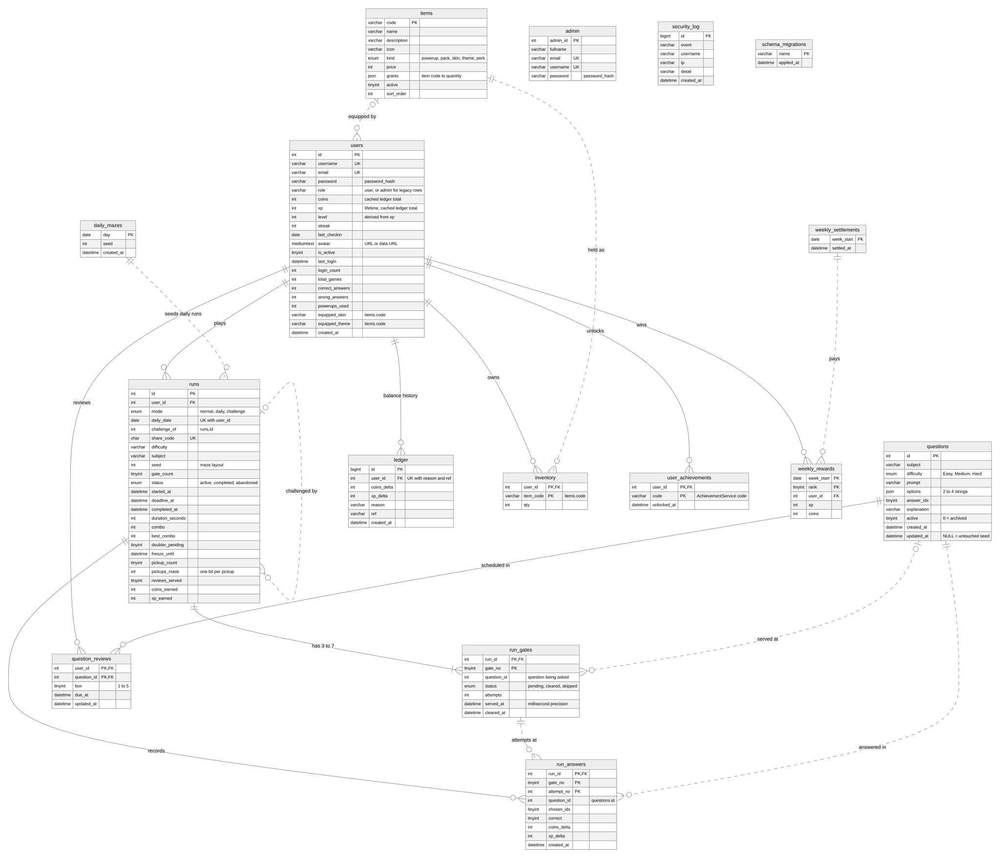

# MazeQuest — Database

MazeQuest stores everything in one MySQL / MariaDB database (InnoDB, `utf8mb4`). The schema is created and changed only by the migrations in [`database/migrations/`](../database/migrations/). This document describes the tables, their keys and relationships, the rules the data must obey, and how the schema is managed.

## 1. Overview

| Group | Tables | Purpose |
|---|---|---|
| Identity | `users`, `admin` | Players and administrators (separate tables, separate sessions) |
| Content | `questions` | The quiz question bank |
| Gameplay | `runs`, `run_gates`, `run_answers` | Every maze attempt, its gates, and every answer given |
| Economy | `ledger`, `items`, `inventory` | Every coin/XP change, the shop catalogue, what players own |
| Learning | `question_reviews` | Spaced-repetition state per player and question |
| Competition | `daily_mazes`, `weekly_settlements`, `weekly_rewards`, `user_achievements` | Daily seeds, weekly prizes, achievements |
| Operations | `security_log`, `schema_migrations` | Login and anti-cheat events; applied migrations |
| Legacy | `legacy_*` | Tables from the original schema, renamed, not used by the code |

There are 16 tables in use. All money and progress tables reference `users(id)` with `ON DELETE CASCADE`, so deleting a player removes everything they own.

## 2. Entity-relationship diagram



**Notation** (crow's foot):
- `||` exactly one, `o|` zero or one, `|{` one or more, `o{` zero or more.
- **Solid lines** are foreign keys the database enforces.
- **Dotted lines** are relationships the application maintains without a FK constraint (see §5).
- `PK` primary key, `FK` foreign key, `UK` unique key.

Source: [diagrams/src/er-diagram.mmd](diagrams/src/er-diagram.mmd) · PNG: [diagrams/png/er-diagram.png](diagrams/png/er-diagram.png)

## 3. Tables

### 3.1 `users` — players

| Column | Type | Notes |
|---|---|---|
| `id` | INT AI | **PK** |
| `username` | VARCHAR(50) | **UK** `uniq_username`. 3–30 chars `[A-Za-z0-9_.-]` (validated in PHP) |
| `email` | VARCHAR(190) | **UK** `uniq_email` |
| `password` | VARCHAR(255) | `password_hash()` output |
| `role` | VARCHAR(20) | `'user'`. Legacy admin rows have `'admin'` and are deactivated; every query filters `role = 'user'` |
| `coins` | INT | **Cached** sum of `ledger.coins_delta`. Never negative |
| `xp` | INT | **Cached** sum of `ledger.xp_delta` (lifetime) |
| `level` | INT | Derived from `xp` (see [algorithm.md §10](algorithm.md#10-level-curve)) |
| `streak`, `last_checkin` | INT, DATE | Daily check-in state |
| `avatar` | MEDIUMTEXT | Image URL or `data:image/…;base64` (≤ 300 KB) |
| `is_active` | TINYINT(1) | Inactive players can't log in and are hidden from leaderboards |
| `last_login`, `login_count` | DATETIME, INT | Login stats |
| `total_games`, `correct_answers`, `wrong_answers`, `powerups_used` | INT | Lifetime counters (denormalised for the profile and achievements) |
| `equipped_skin`, `equipped_theme` | VARCHAR(40) NULL | `items.code` of the equipped cosmetic, or NULL for the default |
| `created_at` | DATETIME | |

**Indexes:** `idx_xp (xp)`, `idx_coins (coins)` for leaderboards.

### 3.2 `admin` — administrators

`admin_id` PK, `fullname`, `email` UK, `username` UK, `password` (hash). Created only with the CLI script `database/create_admin.php`. There is no default account.

### 3.3 `questions` — question bank

| Column | Type | Notes |
|---|---|---|
| `id` | INT AI | **PK** |
| `subject` | VARCHAR(100) | e.g. `Mathematics`. "Mixed Mode" is not stored; it means "any subject" |
| `difficulty` | ENUM('Easy','Medium','Hard') | Default `Medium` |
| `prompt` | VARCHAR(500) | |
| `options` | JSON | Array of 2–4 strings |
| `answer_idx` | TINYINT | Index into `options` |
| `explanation` | VARCHAR(500) NULL | Shown after answering |
| `active` | TINYINT(1) | 0 = archived. Questions are **never deleted**, because answers refer to them |
| `created_at` | DATETIME | |
| `updated_at` | DATETIME NULL | NULL = exactly as seeded. Set when an admin edits or imports. Seed refreshes skip non-NULL rows |

**Indexes:** `idx_subject (subject, active)`, `idx_pick (active, subject, difficulty)`.

### 3.4 `runs` — one maze attempt

| Column | Type | Notes |
|---|---|---|
| `id` | INT AI | **PK** |
| `user_id` | INT | **FK** → `users.id` CASCADE |
| `mode` | ENUM('normal','daily','challenge') | |
| `daily_date` | DATE NULL | Set for daily runs. **UK** `uniq_daily (user_id, daily_date)`, so one daily per player per day. NULLs don't collide |
| `challenge_of` | INT NULL | `runs.id` of the run being challenged (logical reference, no FK) |
| `share_code` | CHAR(8) NULL | **UK** `uniq_share`. Assigned on completion (not for daily runs) |
| `difficulty`, `subject` | VARCHAR | |
| `seed` | INT UNSIGNED | Fully determines the maze layout and pickup positions |
| `gate_count` | TINYINT | 3 / 5 / 7 |
| `status` | ENUM('active','completed','abandoned') | Starting a new run abandons the old one (except an active daily) |
| `started_at`, `deadline_at`, `completed_at` | DATETIME | `deadline_at` NULL = no timer (Easy) |
| `duration_seconds` | INT NULL | Set on completion (DB clock) |
| `combo`, `best_combo` | INT | Current and best streak of correct answers |
| `doubler_pending` | TINYINT(1) | Score doubler armed for the next correct answer |
| `freeze_until` | DATETIME NULL | Time freeze in effect until then |
| `pickup_count`, `pickups_mask` | TINYINT, INT | Pickups in this maze; bit *k−1* set = pickup *k* collected |
| `reviews_served` | TINYINT | Review questions served so far (max 2) |
| `coins_earned`, `xp_earned` | INT | Running totals for this run (a summary; the ledger is the authority) |

**Indexes:** `idx_user_started (user_id, started_at)`, `idx_status (status)`, `idx_daily_rank (daily_date, status, duration_seconds)`.

### 3.5 `run_gates` — gates of a run

**PK** `(run_id, gate_no)`, **FK** `run_id` → `runs.id` CASCADE. Columns:
- `question_id`: the question currently being asked, or NULL. It is cleared after a wrong answer, so the next attempt gets a new question.
- `status`: ENUM pending / cleared / skipped.
- `attempts`.
- `served_at`: DATETIME(**3**), milliseconds, used for the 1-second rule.
- `cleared_at`.

Rows are created together with the run (one per gate).

### 3.6 `run_answers` — every answer given

**PK** `(run_id, gate_no, attempt_no)`. This key is also the **idempotency key**: a retried answer finds the stored row and gets the same result back. Columns: `question_id` (logical reference to `questions.id`), `chosen_idx`, `correct`, `coins_delta`, `xp_delta`, `created_at`.

**FK** `run_id` → `runs.id` CASCADE. **Index:** `idx_question (question_id)`, used for per-question stats and mastery.

### 3.7 `ledger` — every coin and XP change

| Column | Type | Notes |
|---|---|---|
| `id` | BIGINT AI | **PK** |
| `user_id` | INT | **FK** → `users.id` CASCADE |
| `coins_delta`, `xp_delta` | INT | Signed |
| `reason` | VARCHAR(32) | `gate`, `complete`, `pickups`, `daily`, `checkin`, `spin`, `spin_prize`, `purchase`, `wrong_answer`, `weekly_prize`, `signup`, `admin_grant`, `opening_balance` |
| `ref` | VARCHAR(100) | What the change is for, e.g. `run:12:gate:3`, `2026-11-20` |
| `created_at` | DATETIME | |

**UK** `uniq_award (user_id, reason, ref)` guarantees each reward is paid at most once. **Indexes:** `idx_user_time (user_id, created_at)` (the XP chart and spins today), `idx_time (created_at)` (weekly XP). The full list of keys is in [algorithm.md §19](algorithm.md#19-idempotent-rewards--ledger-keys).

### 3.8 `items` and `inventory` — shop

`items`:
- `code` VARCHAR(40) **PK**, `name`, `description`, `icon`.
- `kind` ENUM(powerup, pack, skin, theme, perk).
- `price` INT.
- `grants` JSON, e.g. `{"timeFreeze":1,"hint":1,"skip":1,"scoreDoubler":1}` for the Power-Up Pack.
- `active`, `sort_order`.
- There are 13 rows, 11 active. Speed Boost and Shield are listed but not on sale.

`inventory`:
- **PK** `(user_id, item_code)`, `qty`.
- **FK** `user_id` → `users.id` CASCADE.
- `item_code` references `items.code` logically. Power-ups granted directly (starter kit, wheel prizes) use the same codes.
- Using an item: `UPDATE … SET qty = qty − 1 WHERE … AND qty > 0`, which is atomic and can't go below 0.

### 3.9 `question_reviews` — spaced repetition

**PK** `(user_id, question_id)`. Both are FKs with CASCADE. Columns: `box` (1–5), `due_at`, `updated_at`. **Index:** `idx_due (user_id, due_at)`. A row exists only while the player is still learning that question. It is deleted once the question is learned.

### 3.10 `daily_mazes`

`day` DATE **PK**, `seed`, `created_at`. One row per day, created on the first request that day with `INSERT IGNORE`.

### 3.11 `weekly_settlements` and `weekly_rewards`

- `weekly_settlements`:
  - `week_start` DATE **PK**, `settled_at`.
  - The PK works as a lock: only the request whose insert succeeds pays out.
- `weekly_rewards`:
  - **PK** `(week_start, rank)`. Columns: `user_id` (FK CASCADE), `xp` (a snapshot of that week's XP), `coins`.
  - `rank` is a reserved word in MariaDB, so queries write it as `` `rank` ``.

### 3.12 `user_achievements`

**PK** `(user_id, code)`, `unlocked_at`. **FK** `user_id` CASCADE. `code` is a key of `AchievementService::CATALOGUE`. The names and descriptions live in code, so they can be reworded without a migration.

### 3.13 `security_log`

`id` BIGINT PK, `event` (`login_success`, `login_failed`, `login_failed:admin`, `run_rejected:TOO_FAST`, …), `username`, `ip`, `detail`, `created_at`. **Indexes:** `idx_event_time (event, created_at)`, `idx_ip_time (ip, created_at)`, the second used by login throttling (10 failures per IP per 15 minutes).

### 3.14 `schema_migrations`

`name` VARCHAR(190) PK, `applied_at`. One row per applied migration file.

### 3.15 Legacy tables

Migration 002 renamed the original prototype's tables to `legacy_*` instead of dropping them: `leaderboard`, `game_session(s)`, `player`, `maze`, `games`, `rewards` and the old `user_achievements`. Migration 004 did the same to `user_badges` (now `legacy_user_badges`). The application never reads them. Drop them by hand once the migrated data has been checked.

## 4. Relationships and delete behaviour

| Parent → child | Cardinality | Enforced | On delete of parent |
|---|---|---|---|
| users → runs | 1 : N | FK | cascade |
| runs → run_gates | 1 : 3–7 | FK | cascade |
| runs → run_answers | 1 : N | FK | cascade |
| users → ledger | 1 : N | FK | cascade |
| users → inventory | 1 : N | FK | cascade |
| users → question_reviews | 1 : N | FK | cascade |
| questions → question_reviews | 1 : N | FK | cascade (questions are archived, not deleted, so in practice this doesn't fire) |
| users → user_achievements | 1 : N | FK | cascade |
| users → weekly_rewards | 1 : N | FK | cascade |
| questions → run_answers / run_gates | 1 : N | **no FK** | — (questions are never deleted) |
| items → inventory, users.equipped_* | 1 : N | **no FK** | — (items are deactivated, not deleted) |
| runs → runs (`challenge_of`) | 0..1 : N | **no FK** | the challenger's run keeps a dangling id (see §9) |
| daily_mazes → runs (`daily_date`) | 1 : N | **no FK** | — (daily rows are never deleted) |
| weekly_settlements → weekly_rewards | 1 : 0–3 | **no FK** | — |

## 5. Integrity rules (invariants)

| # | Rule | How it is guaranteed |
|---|---|---|
| I1 | `users.coins = Σ ledger.coins_delta` and `users.xp = Σ ledger.xp_delta` | Only `ProgressionService` changes them, always in the same transaction as the ledger insert. The test suite asserts it after every money-moving test |
| I2 | A reward is paid at most once | `ledger.uniq_award (user_id, reason, ref)` + `INSERT IGNORE` |
| I3 | Coins never go negative | `UPDATE … WHERE coins >= ?`; penalties take `min(penalty, balance)` |
| I4 | An answer attempt is recorded once | PK `(run_id, gate_no, attempt_no)` + lookup before grading |
| I5 | One daily run per player per day | `uniq_daily (user_id, daily_date)` |
| I6 | One seed per day | PK `daily_mazes.day` + `INSERT IGNORE` |
| I7 | Weekly prizes paid once per week | PK `weekly_settlements.week_start` as a lock + ledger key `weekly_prize/{week}` |
| I8 | Share codes are unique | `uniq_share` + retry on collision |
| I9 | Achievements unlock once | PK `(user_id, code)` + `INSERT IGNORE` |
| I10 | Inventory quantities ≥ 0 | `UPDATE … SET qty = qty − 1 WHERE qty > 0` |
| I11 | `level = levelForXp(xp)` | Recomputed inside every `credit` |
| I12 | Answer history stays valid | Questions are archived (`active = 0`), never deleted |

## 6. Query patterns and indexes

| Query | Where | Index used |
|---|---|---|
| Find a run for this player, locked | every run endpoint | PK `runs.id` (+ `user_id` check) |
| Gate state, locked | question / answer | PK `run_gates` |
| Retry lookup | answer | PK `run_answers` |
| Pick a question | question | `idx_pick (active, subject, difficulty)`; `NOT IN` subqueries use the `run_answers` / `run_gates` PKs |
| Due review | question | `idx_due (user_id, due_at)` |
| Pay a reward | everywhere | `uniq_award` (duplicate check) |
| Spins today, XP chart | dashboard | `idx_user_time` |
| Leaderboard by XP / coins | `/api/leaderboard` | `idx_xp`, `idx_coins` (streak: filesort, fine at this size) |
| Weekly leaderboard / settlement | `/api/leaderboard?type=weekly`, `/api/me` | `idx_time` range scan + group by user |
| Daily leaderboard / rank | daily | `idx_daily_rank (daily_date, status, duration_seconds)` |
| Login throttle | login | `idx_ip_time` |
| Admin question search | admin | `LIKE '%…%'` is a full scan of `questions` (145 rows; fine) |

## 7. Normalisation and deliberate denormalisation

The schema is in third normal form, with these deliberate exceptions:

| Denormalised data | Why | Kept correct by |
|---|---|---|
| `users.coins`, `xp`, `level` | Leaderboards and every page need them; summing the ledger each time would be slow | I1, I11 |
| `users.total_games`, `correct_answers`, `wrong_answers`, `powerups_used` | Cheap counters for the profile and the `scholar` achievement | Incremented in the same transaction as the event |
| `runs.coins_earned`, `xp_earned` | Shown in the admin activity feed | Updated with each ledger change for the run |
| `weekly_rewards.xp` | Snapshot of the winning XP | Written once at settlement |
| `questions.options` as JSON | Options are always read and written together; 2–4 per question | Validated in `QuestionService` |

## 8. Data volume (estimate)

| Per… | Rows written | Approx. size with indexes |
|---|---|---|
| Normal Medium run | 1 `runs` + 5 `run_gates` + ~6 `run_answers` + ~8 `ledger` | ~3 KB |
| Player per day (5 runs, check-in, 3 spins) | ~100 | ~16 KB |
| 1,000 daily players for a year | ~37 million | ~6 GB |

The largest tables over time are `ledger`, `run_answers` and `security_log`. None has a retention policy yet (see §9).

## 9. Migrations

`php database/migrate.php` (CLI only; it refuses to run from the web):
- Creates `schema_migrations` if needed.
- Runs every `database/migrations/*.php` file not yet recorded, in name order.
- Records each one after it succeeds.

Each file returns `function (PDO $db, Migrator $m)`. The `Migrator` helpers (`tableExists`, `columnExists`, `indexExists`, `addColumn`) let a migration adapt to an existing legacy database instead of failing on it.

| File | What it does |
|---|---|
| `001_core_schema` | Creates every core table; brings an older `users` table up to date in place (adds columns, widens `avatar`, adds indexes) |
| `002_migrate_legacy_data` | Converts per-level XP to lifetime XP; writes `opening_balance` ledger rows; grants starter power-ups; deactivates legacy admin rows in `users`; renames old tables to `legacy_*` |
| `003_seed_questions_and_items` | Seeds the first 34 questions (only into an empty table) and upserts the shop items |
| `004_learning_and_engagement` | Adds difficulty/explanation/`updated_at` to questions and upserts the 145-question seed (refreshing only untouched rows); adds `question_reviews`, `daily_mazes`, `weekly_*`, `user_achievements` (migrating badges); adds run modes, share codes, pickups and summary fields; adds equipped cosmetics; adds the streak freeze and opens the Forest/Space themes |

**Rules for a new migration:**
- Add a new numbered file. Never edit an applied one.
- Make it safe to run against both a fresh database and an existing one. Check before you add.
- There are no down-migrations: **take a backup first**.

```bash
# Backup and restore (Docker)
docker compose exec -T db mariadb-dump -uroot -proot mazequest > backup.sql
docker compose exec -T db mariadb -uroot -proot mazequest < backup.sql
```

## 10. Known issues and recommendations

| Issue | Impact | Recommendation |
|---|---|---|
| `users.avatar` holds images up to ~300 KB, and leaderboard queries select it | A 100-row leaderboard can be tens of MB | Store avatars as files or in object storage; keep a URL, or select a thumbnail |
| `runs.challenge_of` has no FK | Deleting the original player leaves friends' challenge runs pointing at a missing run. The opponent shows blank and PHP logs warnings | Add `FOREIGN KEY … ON DELETE SET NULL` and handle NULL in `RunService::state` |
| No retention for `security_log`, `ledger`, `run_answers` | Unbounded growth | Archive or delete `security_log` after ~90 days; keep the ledger, maybe partitioned by month at scale |
| Day and week boundaries use the database time zone | In Docker that is UTC, so the "day" resets at 00:00 UTC for everyone | Set the DB `time_zone` to the audience's zone, or store a configured zone |
| Players are hard-deleted | All their history is lost; their challenge links stop working | Prefer deactivation (`is_active = 0`), already supported by the schema |
| `legacy_*` tables remain | Clutter | Drop them once you're confident in the migrated data |
