# MazeQuest — System Design

This document covers MazeQuest as a system:
- what it must do (requirements);
- how data moves through it (context diagram, DFD levels 0–2, the system flowchart);
- how the API, consistency and security are designed;
- how it would scale;
- what the review of the whole codebase found.

For the code structure, see [architecture.md](architecture.md). For the schema, see [database.md](database.md). For the algorithms, see [algorithm.md](algorithm.md).

All diagrams are in [diagrams/](diagrams/README.md) as SVG (shown here), PNG (for documents) and Mermaid source.

## 1. Scope

**In scope:** the MazeQuest web application. That covers the player game, the progression systems, the public pages and the admin panel, with one PHP application and one relational database.

**Out of scope:** email delivery, payments, native apps, analytics pipelines, and multi-region hosting.

## 2. Requirements

### 2.1 Functional requirements

| ID | Requirement |
|---|---|
| FR1 | Guests can register, log in and see public pages, leaderboards and challenge pages |
| FR2 | Players can play a maze of a chosen difficulty and subject; each gate asks a question that must be answered correctly to pass |
| FR3 | The server scores every answer and completion: coins, XP, combo, penalties, time bonus |
| FR4 | After an answer, the player sees the correct option and an explanation |
| FR5 | Missed questions return in later mazes on a spaced schedule; per-subject mastery is shown |
| FR6 | A shared daily maze: same maze and questions for everyone, one attempt, ranked by time |
| FR7 | Challenge links: a friend plays the same maze and questions, and the times are compared |
| FR8 | Daily check-in with a streak and streak freezes; a limited daily spin wheel |
| FR9 | Shop: power-ups, packs, perks and cosmetics; equip and unequip |
| FR10 | Power-ups during a run (time freeze, hint, skip, score doubler); coin pickups paid on completion |
| FR11 | Leaderboards: XP, coins, level, streak, weekly, daily; weekly top-3 prizes |
| FR12 | 13 achievements unlocked by the server |
| FR13 | Admins can view stats, analytics and the security log, add and delete players, manage questions (CRUD, archive, CSV import), and export data |

### 2.2 Non-functional requirements

| ID | Quality | Target | How it is met |
|---|---|---|---|
| NFR1 | **Integrity** | No way to create coins or XP from the browser; no reward paid twice | Server-authoritative rules, ledger with unique keys, row locks (§10) |
| NFR2 | **Latency** | Game API calls under 100 ms at the server for a small population | One transaction of a few indexed queries per call; no external calls |
| NFR3 | **Fairness** | Every player in a daily or challenge maze gets the same maze and questions | Seeded generation; deterministic question order (algorithm.md §1, §7) |
| NFR4 | **Security** | OWASP basics: no SQL injection or XSS; safe sessions; throttled logins | §11 |
| NFR5 | **Portability** | Runs on shared hosting / XAMPP as well as Docker | No framework, no Composer, no build step, no cron |
| NFR6 | **Usability** | Works on phones (touch controls) and keyboard-only; light/dark | Responsive layout, D-pad, keyboard shortcuts |
| NFR7 | **Maintainability** | Rules changed in one place; code readable end to end | `GameRules`, strict layering, a 29-test integration suite |
| NFR8 | **Recoverability** | Schema changes never lose data | Forward-only, adaptive migrations; legacy tables renamed, not dropped |

### 2.3 Constraints and assumptions

- **Team and stack:**
  - Built by a single developer.
  - PHP and MySQL were the starting point and stay.
  - Must run where only PHP + MySQL + Apache are available.
- **Expected load:** a classroom or community scale of hundreds to low thousands of daily players. §13 estimates where the limits are.
- **Clock:** the database clock is the source of truth for all times.

## 3. Context diagram

The whole system as one process, with its three external entities.


| Entity | Sends | Receives |
|---|---|---|
| Guest | sign-up details, credentials, challenge codes | public pages, leaderboards, challenge details, a session |
| Player | run events (start, answers, power-ups, pickups, finish), check-in, spin, purchases, profile changes | maze seed and run state, questions, feedback, rewards, summaries, rankings, achievements |
| Administrator | admin credentials, new players, question edits, CSV imports | statistics, analytics, player list, security log, question stats, exports |

## 4. Data-flow diagram — level 0

**Notation:**
- External entities are grey rectangles.
- Processes are blue rounded boxes, numbered.
- Data stores are orange cylinders: D1–D11 map to database tables, and D12 is the PHP session store.
- Arrows are labelled with the data that flows. A two-headed arrow means the process both reads and writes the store.


| Process | Responsibility | Main stores |
|---|---|---|
| 1.0 Manage accounts and sessions | Register, log in (player and admin), profile, password, logout | D1, D2, D6, D11 |
| 2.0 Play a maze run | Start, serve questions, grade answers, power-ups, pickups, timeout, complete | D3, D4, D6, D7, D8, D11 |
| 3.0 Award progression and daily rewards | The only writer of coins and XP; check-in, spin, wallet | D1, D5, D6 |
| 4.0 Shop and inventory | Catalogue, purchases, equipping cosmetics | D1, D6 |
| 5.0 Track learning | Review boxes, due reviews, mastery | D3, D4, D7 |
| 6.0 Competition and achievements | Leaderboards, daily maze, weekly settlement, challenges, achievements | D1, D3, D4, D5, D8, D9, D10 |
| 7.0 Administer the system | Stats, players, questions, CSV import, security log, export | D1, D2, D3, D4, D6, D11 |

| Store | Tables |
|---|---|
| D1 users · D2 admin · D3 questions | `users` · `admin` · `questions` |
| D4 runs | `runs`, `run_gates`, `run_answers` |
| D5 ledger · D6 items, inventory | `ledger` · `items`, `inventory` |
| D7 question_reviews · D8 daily_mazes | `question_reviews` · `daily_mazes` |
| D9 weekly · D10 achievements · D11 security log | `weekly_settlements`, `weekly_rewards` · `user_achievements` · `security_log` |

## 5. Data-flow diagrams — level 1

Each level-0 process is broken down into its sub-processes. Dashed boxes are processes from other parts of the system, shown for context.

### 5.1 Process 1.0 — Manage accounts and sessions


- **Registration (1.1):** creates the account, then asks 3.0 to credit the starter coins, all in one transaction.
- **Login (1.2, 1.3):** reads the recent failures for the client IP before checking the password. Every outcome is written to the security log, and the session ID is regenerated.

### 5.2 Process 2.0 — Play a maze run


- **Starting a run (2.1):**
  - Abandons any other active run, except today's daily maze.
  - Creates the run and its gate rows.
  - Returns the seed. The browser builds the maze from it.
- **Locking:** 2.2–2.7 all lock the run row first. Rejections that suggest tampering are logged to D11.

### 5.3 Process 3.0 — Award progression and daily rewards


- **3.1 Credit once** is the single entry point for adding coins or XP. It inserts the ledger row first. If that row already exists, nothing is paid.
- **3.2 Spend or penalise** never lets a balance go below zero.

### 5.4 Process 4.0 — Shop and inventory


### 5.5 Process 5.0 — Track learning


### 5.6 Process 6.0 — Competition and achievements


- **6.2 Issue daily maze** and **6.3 Settle weekly prizes** are *lazy*. They run inside ordinary requests, with database keys as locks, so no scheduler is needed.

### 5.7 Process 7.0 — Administer the system


## 6. Data-flow diagrams — level 2

These are the three processes where the game's correctness and fairness are decided.

### 6.1 Process 2.2 — Serve a question


Selection priority:
1. A question already served at this gate.
2. In a challenge, the friend's question.
3. In the daily maze, the seeded order.
4. A due review, at most 2 per run.
5. A random question, matching difficulty first.

The answer index is removed before the question is sent.

### 6.2 Process 2.3 — Grade an answer


- **Idempotency first (2.3.1):** a retried attempt returns the stored outcome.
- **Validation (2.3.2):** the gate must be pending and the deadline not passed. A question must have been served, the attempt number must be next in sequence, at least 1 s must have passed since serving, and the option must be in range.
- **Scoring:** a correct answer pays through 3.1, and a wrong one is penalised through 3.2. Either way the answer is recorded, the review box updated, and achievements checked.

### 6.3 Process 2.7 — Complete a run


- **Validation:** every gate cleared or skipped, minimum time passed, deadline not passed.
- **Pay once:** completion, pickups and the daily bonus each use their own ledger key.
- **Close:** mark the run completed with its duration.
- **Then:** build the summary (including missed questions), assign a share code, compare with the challenger or the daily board, and check achievements.

## 7. System flowchart

A player's whole journey, from opening the site to finishing a maze, including the server's decisions.


## 8. High-level design


- **Client:**
  - Server-rendered pages, plus one script per page.
  - The game page draws the maze on a canvas from the seed.
  - It talks to the JSON API with `fetch`, using the same-origin session cookie.
- **Application:**
  - PHP, one process per request.
  - Router → Controller → Service → Repository.
  - All rules are in `GameRules` and the services.
- **Data:** MySQL/MariaDB (InnoDB). PHP file sessions.
- **Deployment:** see [architecture.md §7](architecture.md#7-deployment-view).

**Key interaction:** answering a gate, end to end.

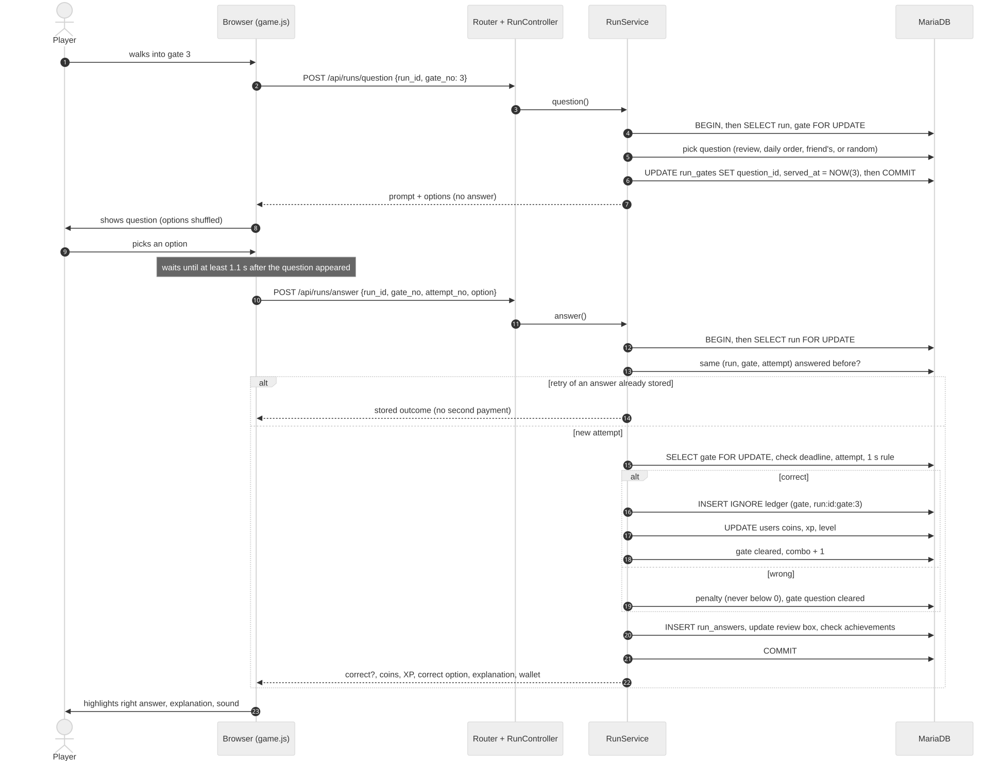

## 9. API design

### 9.1 Conventions

- **Format:** JSON in, JSON out, under `/api/`. Request bodies are `application/json`; form-encoded bodies are also accepted.
- **Success:** `{"success": true, …data}`.
- **Error:** `{"success": false, "code": "MACHINE_CODE", "message": "Human text"}` with the matching HTTP status.
- **Auth:** the session cookie. Route guards: none (public), `player`, `admin`.
- **Methods:** `GET` for reads, `POST` for every change. All IDs travel in the body or query string; there are no path parameters.
- **Caching:** every JSON response is sent with `Cache-Control: no-store`.

| Status | Codes |
|---|---|
| 401 | `UNAUTHENTICATED` |
| 403 | `FORBIDDEN` (deactivated account) |
| 404 | `NOT_FOUND` |
| 405 | `METHOD_NOT_ALLOWED` |
| 409 | game and state conflicts: `RUN_NOT_ACTIVE`, `GATE_NOT_PENDING`, `GATES_PENDING`, `TOO_FAST`, `EXPIRED`, `NOT_EXPIRED`, `WRONG_ATTEMPT`, `NO_QUESTION_SERVED`, `NO_QUESTIONS`, `DAILY_DONE`, `OWN_CHALLENGE`, `INSUFFICIENT_COINS`, `ALREADY_OWNED`, `MAX_OWNED`, `NOT_OWNED`, `NO_POWERUP`, `NO_TIMER`, `ALREADY_FROZEN`, `ALREADY_ACTIVE`, `SPIN_LIMIT`, `TAKEN`, `DUPLICATE` |
| 422 | validation: `INVALID_INPUT`, `INVALID_GATE`, `INVALID_OPTION`, `INVALID_PICKUP`, `INVALID_POWERUP`, `INVALID_MODE`, `INVALID_DIFFICULTY`, `INVALID_SUBJECT`, `INVALID_USERNAME`, `INVALID_EMAIL`, `WEAK_PASSWORD`, `PASSWORD_MISMATCH`, `WRONG_PASSWORD`, `INVALID_AVATAR`, `AVATAR_TOO_LARGE`, `INVALID_QUESTION`, `INVALID_ANSWER`, `CSV_EMPTY`, `CSV_HEADER`, `CSV_TOO_LARGE` |
| 429 | `RATE_LIMITED` (login throttle) |
| 500 | `SERVER_ERROR` (details only when `APP_DEBUG=true`) |

### 9.2 Endpoints

| Method | Path | Guard | Purpose |
|---|---|---|---|
| POST | `/api/auth/register` · `/login` · `/admin-login` · `/logout` | — | Accounts |
| POST | `/api/auth/password` | player | Change password |
| GET / POST | `/api/me` | player | Profile, wallet, achievements, learning, weekly winners, daily state / edit profile |
| POST | `/api/checkin` · `/api/spin` | player | Daily rewards |
| GET | `/api/shop` · POST `/api/shop/buy` · `/api/shop/equip` | player | Shop |
| GET | `/api/daily` | player | Today's maze status and top times |
| GET | `/api/leaderboard?type=&limit=` | — | Boards |
| POST | `/api/runs/start` · `question` · `answer` · `powerup` · `pickup` · `complete` · `timeout` | player | The game |
| GET | `/api/admin/stats` · `users` · `activity` · `security-logs` · `analytics` · `export` · `questions` | admin | Admin reads |
| POST | `/api/admin/users` · `users/delete` · `password` · `questions` · `questions/status` · `questions/import` | admin | Admin writes |

### 9.3 Core game contracts

```http
POST /api/runs/start        {"mode":"normal","difficulty":"Medium","subject":"Science"}
                            {"mode":"daily"}   |   {"mode":"challenge","code":"K7QX2MPA"}
→ 200 {"success":true,"resumed":false,"run":{"run_id":42,"mode":"normal","difficulty":"Medium",
       "subject":"Science","seed":1849211923,"gate_count":5,"status":"active","seconds_left":150,
       "frozen":false,"combo":0,"doubler":false,"pickup_count":4,"pickups":[],"gates":[{"gate_no":1,"status":"pending"},…]}}

POST /api/runs/question     {"run_id":42,"gate_no":1}
→ 200 {"gate_no":1,"attempt_no":1,"is_review":false,"question_id":17,"subject":"Science",
       "difficulty":"Medium","prompt":"…","options":["…","…","…","…"]}            ← no answer

POST /api/runs/answer       {"run_id":42,"gate_no":1,"attempt_no":1,"option":2}
→ 200 {"correct":true,"coins":10,"xp":5,"combo":1,"correct_idx":2,"explanation":"…",
       "was_review":false,"replayed":false,"new_achievements":[],"run":{…},"wallet":{…}}

POST /api/runs/complete     {"run_id":42}
→ 200 {"coins":93,"xp":30,"time_bonus":18,"pickup_coins":20,"daily_bonus":null,"level_up":null,
       "summary":{"duration_seconds":61,"answered":6,"correct":5,"wrong":1,"accuracy":83,
                  "best_combo":4,"skipped":0,"pickups":4,"pickup_count":4,"missed":[{…}]},
       "share_code":"K7QX2MPA","challenge":null,"daily":null,"new_achievements":[…],"wallet":{…}}
```

### 9.4 Retries and idempotency

| Call | Safe to retry? | Mechanism |
|---|---|---|
| `question` | yes | The gate keeps its served question; the same one is returned |
| `answer` | yes | PK `(run, gate, attempt)`; the stored outcome is returned (`replayed: true`) |
| `pickup` | yes | Bitmask update only when the bit is unset (`collected: false` on a repeat) |
| `complete` | no second payment | The run is no longer active (`RUN_NOT_ACTIVE`); ledger keys block double payment anyway |
| `checkin` | yes | `last_checkin = today` returns "already checked in"; ledger key = date |
| `buy` | **no** | Each purchase is a new ledger ref by design; the client disables the button while the request is in flight |
| `spin` | **no** | Each spin is a new spin number; capped at 3 a day |

The game client retries `answer` automatically, up to 2 times, on network errors.

## 10. Consistency and concurrency

- **One transaction per state change.** `Database::transaction()` wraps every service method that writes. Any exception rolls everything back.
- **Row locks:**
  - Run endpoints lock the run with `SELECT … FOR UPDATE`, which serialises actions within one run.
  - Gate updates lock the gate.
  - Balance changes lock the user row.
  - Check-in, spin and the daily start also lock the user row, to serialise them per player.
- **Uniqueness as the final guard.** If two requests slip through, a unique key decides:

  | Key | Guards |
  |---|---|
  | `ledger.uniq_award` | rewards |
  | `run_answers` PK | answers |
  | `runs.uniq_daily` | daily attempts |
  | `daily_mazes` PK | daily seed |
  | `weekly_settlements` PK | weekly payout |
  | `uniq_share` | share codes |
  | `user_achievements` PK | achievements |

- **Conditional updates:** `coins >= ?`, `qty > 0` and `(mask & bit) = 0` make spending, power-ups and pickups atomic, with no read-then-write races.
- **Single clock.** All time comparisons happen in SQL (`NOW()`, `NOW(3)`, `TIMESTAMPDIFF`), so PHP and database clocks can't disagree.
- **Security log outside the transaction.** Rejected-event log entries are written after the rollback, so they are kept.

## 11. Security design

| Threat | Mitigation |
|---|---|
| Editing coins/XP from the console | Server-authoritative; `/api/me` can only change username, email and avatar |
| Replaying or duplicating rewards | Ledger `UNIQUE(user_id, reason, ref)`; idempotent answers |
| Answering by script / guessing | 1-second minimum after serving; second try pays half, third nothing; minimum run time; rejections logged |
| Shopping for an easier question | A gate keeps its served question until it's answered |
| Seeing answers in the page source | Questions are fetched one at a time without `answer_idx`; the answer is revealed only after an answer is recorded, and a wrong answer gets a new question |
| SQL injection | PDO native prepared statements; dynamic column names only from code whitelists |
| XSS | `e()` in views, `App.escape`/`textContent` in JS, `JSON_HEX_TAG` for embedded JSON; SVG avatars only ever shown through `` |
| Session fixation / theft | `session_regenerate_id(true)` on login; `HttpOnly`, `SameSite=Lax`, `Secure` on HTTPS |
| CSRF | `SameSite=Lax` cookies (no cookie on cross-site POSTs); every change is a POST |
| Brute-force login | 10 failures per IP per 15 minutes → 429 |
| Open redirect via `?next=` | Only same-site paths matching a strict pattern |
| Direct access to source/config | Only `public/` is web-reachable (`DocumentRoot` or root `.htaccess` rewrite) |
| Running migrations from the web | `migrate.php` exits unless run from the CLI |
| Default credentials | None; admins are created from the CLI |
| Leaking internals | Errors are logged; responses show a generic message unless `APP_DEBUG=true` |

## 12. Review findings

The review covered every PHP file under `src/`, the migrations, the main client scripts, the Docker setup and the test suite, and checked behaviour against the running app.

### 12.1 Strengths

- **Correct trust model.** Every reward is decided and recorded on the server, and the ledger makes balances explainable and testable.
- **Concurrency handled deliberately.** Row locks, conditional updates and unique keys work together. Client retries are safe.
- **Clean layering.** SQL is confined to repositories, and rules to `GameRules` and the services. The code is small enough to read end to end.
- **Deterministic content from seeds.** One integer gives replays, daily mazes and challenges at no storage cost.
- **Careful migrations.** They upgrade a legacy database in place, never drop data, and never overwrite admin-edited questions.
- **Real tests.** The integration suite drives the HTTP API against a fresh database and checks the ledger invariant.

### 12.2 Findings

Severity reflects impact at the expected scale (hundreds to thousands of players).

| # | Severity | Area | Finding | Recommendation |
|---|---|---|---|---|
| F1 | **Medium** | Performance | Leaderboard responses include every row's `avatar`, which can be a data URL of up to ~300 KB. The dashboard requests the weekly board with `limit=100` on every load, only to find the player's own rank, and the leaderboard page requests 50 rows. With many uploaded avatars, one response can reach tens of MB | Return the player's weekly rank from `/api/me` instead of fetching 100 rows; serve avatars from a separate cacheable endpoint or file storage, and return a URL or a small thumbnail in lists |
| F2 | **Medium** | Integrity | Movement is not validated. A modified client can jump to gates and the exit; it still has to answer every gate and respect minimum times. Pickup positions are trusted the same way (bounded at 5 × 5 coins a run) | Port `generateMaze`/`solutionPath` to PHP (deterministic from the seed) and check gate order and pickup cells; or accept the risk, since rewards are dominated by answers |
| F3 | **Medium** | Fairness | Challenges can be retried without limit, so a friend can learn the questions before posting a winning time | Add `UNIQUE(user_id, challenge_of)`, or count only the first attempt as "won" |
| F4 | **Medium** | Accounts | No password reset or email verification. Registration has no rate limit or CAPTCHA. The login throttle is per IP only, so shared networks such as schools can lock each other out and distributed guessing isn't limited | Add a reset-by-email flow; throttle registration; add a per-account failure counter with backoff |
| F5 | **Medium** | Scalability | PHP file sessions and per-process state tie the app to one web node | Use a database or Redis session handler before adding a second node |
| F6 | Low | Data | `runs.challenge_of` has no foreign key. Deleting a player whose run was challenged leaves the friend's run pointing at a missing row; `RunService::state()` then reads a null source (PHP warnings, blank opponent) | `FOREIGN KEY … ON DELETE SET NULL` and a null check; prefer deactivating players over deleting them |
| F7 | Low | Time | Day and week boundaries use the database time zone, which is UTC in Docker, so "today's maze" and check-ins roll over at 00:00 UTC for everyone | Configure the DB `time_zone` for the audience, or make the zone a setting |
| F8 | Low | Concurrency | `credit()` inserts the ledger row before locking the user row, while `spend()` updates the user row first. The lock orders differ between two paths for the same player. A deadlock is unlikely but possible under concurrent requests from one player, and would surface as a 500 | Lock the user row first in `credit()`, so every path takes locks in the same order |
| F9 | Low | Operations | No retention for `security_log`, `ledger`, `run_answers`; no automated backups; no CI running the tests | A cleanup job for logs older than 90 days; scheduled `mariadb-dump`; a CI workflow running `tests/run.php` |
| F10 | Low | Privacy | Avatar URLs on any `http(s)` host are allowed, so other players' browsers fetch images from arbitrary hosts, exposing their IPs | Allow uploads only, or proxy and cache external images |
| F11 | Low | Admin | One admin role, no 2FA, and no record of which admin changed a question or deleted a player | An audit table (`admin_id`, action, target, time); optional TOTP |
| F12 | Info | Client | Answer options are shuffled with `sort(() => Math.random() − 0.5)`, which is slightly biased | Use a Fisher–Yates shuffle (already used for the maze) |
| F13 | Info | Product | A resumed daily maze puts the player back at the entrance (gates and coins are kept); Forest/Space themes ignore dark mode; Speed Boost and Shield are listed but not implemented | Track as backlog items |

No high-severity issues (data loss, privilege escalation, injection) were found.

## 13. Scale and reliability

### 13.1 Load estimate

**Assumptions:** 1,000 daily active players, 5 mazes each, peak hour = 20% of daily traffic.

| Quantity | Estimate |
|---|---|
| API calls per maze | ~20–30: start, question + answer per gate attempt, pickups, complete, plus `/api/me` and the leaderboard |
| Calls per day | 1,000 × 5 × 25 ≈ **125,000** |
| Average / peak rate | ≈ 1.5 req/s average; ≈ **7 req/s** in the peak hour; bursts of maybe 30 req/s |
| Database work per call | 1 transaction, 3–10 indexed queries |
| Storage growth | ≈ 16 KB per player-day → ≈ 6 GB per year (database.md §8) |

A single small VM (2 vCPU, 2–4 GB RAM) running PHP-FPM and MariaDB handles this comfortably. PHP easily serves hundreds of such requests per second. The first bottlenecks would be:
1. Large leaderboard payloads (F1).
2. `ORDER BY RAND()` once the question bank reaches tens of thousands of rows.
3. Weekly-leaderboard aggregation over a large `ledger`.

### 13.2 Scaling path

| Stage | Change |
|---|---|
| 1 (now → 10k DAU) | Fix F1; HTTPS; PHP-FPM with OPcache; daily backups; set the DB time zone |
| 2 (10k → 100k DAU) | Sessions in Redis; 2+ stateless web nodes behind a load balancer; a read replica for leaderboards and admin analytics; cache leaderboards for 30–60 s |
| 3 (beyond) | Precomputed leaderboards (a table updated on credit, or a Redis sorted set); partition `ledger`/`run_answers` by month; move weekly settlement and retention to a queue or cron |

### 13.3 Caching strategy

There is no application cache today. Every number is read live, which keeps the system simple and correct at the current scale. In order of value, the candidates are:

1. **Leaderboards:** public, read-heavy and tolerant of staleness. Cache for 30–60 s.
2. **Question bank and subjects:** rarely change. Cache in APCu and invalidate on admin save.
3. **Static assets:** already plain files. Add long `Cache-Control` headers with versioned URLs.

Player state (wallet, runs) should stay uncached, because correctness matters more there.

### 13.4 Failure modes

| Failure | Effect | Handling |
|---|---|---|
| Network blip during an answer | The client didn't get the result | Automatic retry of the same attempt; the server returns the stored outcome |
| Browser closed mid-maze | The run stays `active` | The next start abandons it, except the daily maze, which can be resumed |
| Database unavailable | All API calls fail | Generic 500 with JSON error; the client shows a toast. Needs monitoring (below) |
| Two first requests of the day / week | Race on the seed or settlement | Primary keys let exactly one win |
| Bad migration | Schema half-changed (MySQL DDL isn't transactional) | Back up first; migrations are written to be re-runnable (`IF NOT EXISTS`, column checks) |

### 13.5 Monitoring and alerting (recommended)

- **Health check:** `GET /` returns 200; an API probe calls `/api/leaderboard?limit=1`.
- **Alerts:**
  - 5xx rate above 1%.
  - p95 latency above 500 ms.
  - A spike in `security_log` `run_rejected:*` or `login_failed` events.
  - Disk usage of the database volume.
- **Weekly check:** a ledger-invariant query, `users.coins = SUM(ledger.coins_delta)` for every player. It should always return zero mismatches.

## 14. Trade-offs

| Decision | Gained | Gave up |
|---|---|---|
| Server-authoritative answers with one request per gate | Integrity, real-time feedback, answer data for learning | Needs a network connection; more requests than a client-scored game |
| Client-side maze generation from a seed | No maze storage; instant rendering; free replays, daily mazes and challenges | Movement can't be verified without porting generation to PHP |
| Ledger + cached totals | Auditability, idempotency, a testable invariant | Two writes per change; discipline (only `ProgressionService` may write) |
| Lazy settlement, no cron | Runs on any host | Settlement depends on traffic; idle weeks are skipped |
| No framework | Portability, a small codebase, no build | Re-implemented basics; fewer guard rails for new contributors |
| One database, no cache | Simplicity and correctness | Will need caching and replicas at much larger scale |

## 15. Roadmap

1. **Before a public launch:**
   - F1: avatars out of list responses.
   - F4: password reset and registration throttling.
   - F7: time zone.
   - HTTPS, backups, CI (F9).
2. **Next:**
   - F3: one attempt per challenge.
   - F6: challenge FK.
   - F8: lock order.
   - Admin audit log (F11).
   - Save the player's position in a resumed daily maze.
3. **Later, if needed:**
   - Server-side maze validation (F2).
   - Redis sessions and caching.
   - Precomputed leaderboards.
   - Implement or remove Speed Boost and Shield.
